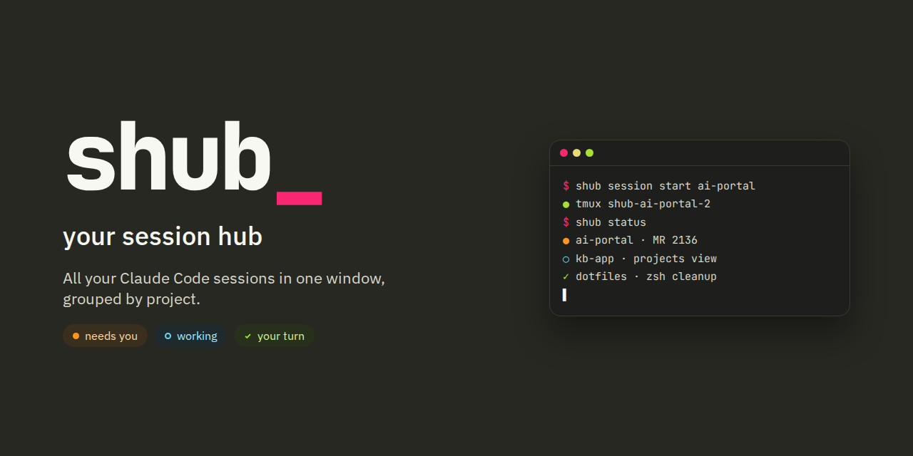

<p align="center"></p>

# shub — your session hub

All your Claude Code sessions in one window, grouped by project. shub runs the real Claude Code CLI in tmux on your
machine and shows it in the browser: one sidebar row per session, a control center for its panes, a badge when a session needs you, the Docker services of the
session's worktree next to it, and a phone view to answer permission questions on the go.

> Status: early. Version scheme: CalVer `YYYY.M.MICRO`.

## Requirements

Linux or macOS, Node 24+, tmux 3.3+, Claude Code, optionally Docker and Tailscale. Windows only inside WSL2: install
and run shub there.

## Quickstart (5 min)

1. Run `claude` once in a terminal and log in. shub starts the real Claude Code, so it must already work.
2. Install and set up: `npm i -g @christoph-teichmeister/shub && shub install` (the guided setup checks Node, tmux and
   Claude Code and says how to install what is missing).
3. Open <http://127.0.0.1:4780> (`shub open`) and paste the token from `shub token`.
4. Add a project: use the app's "Add a project" page (it has a folder picker) or `shub project add ~/code/my-repo`.
5. Press **New session** on a project. Claude starts in a terminal in the browser; the sidebar row shows when it needs you.

Something wrong? Run `shub doctor` and see [docs/TROUBLESHOOTING.md](docs/TROUBLESHOOTING.md).

## Words you will see

- **Project**: a folder (usually a git repo) you work in. **Group**: a heading in the sidebar that holds projects.
- **Session**: one running Claude Code (or a plain terminal) in a project, kept alive in tmux.
- **Pane**: one terminal inside a session, its Claude or an extra Claude or shell. Panes sit in tabs or splits.
- **Control center**: the right side of the app, where the open session's panes live.
- **Button** (skill button): a one-click shortcut that runs a Claude skill in a new session. Tick skills in
  Project settings (the gear next to a project) > Buttons from skills.
- **Worktree**: a second checkout of the same repo on its own branch; the Worktrees button lists and opens them.
- **Waiting**: a session you parked until something outside happens (a build, a review).

All features: [docs/FEATURES.md](docs/FEATURES.md).

## Install

```sh
npm i -g @christoph-teichmeister/shub && shub install
```

The npm package is only the launcher (`shub`). In a terminal, `shub install` walks you through the setup: it checks
Node, tmux and Claude Code (and says how to install what is missing), downloads the latest signed release from GitHub,
runs it as a systemd user unit (Linux) or a launchd agent (macOS) at http://127.0.0.1:4780 and prints the access token
you log in with (`shub token` prints it again). Run again over an installed service, it keeps that service's port and
phone address. `shub install --advanced` also asks for the update channel, port and phone address. For scripts,
`shub install --yes [--channel beta]` only installs the release, and `shub service install` adds the service.
`shub doctor` says what is missing (help: [docs/TROUBLESHOOTING.md](docs/TROUBLESHOOTING.md)). Versions live side by
side in `~/.local/share/shub/versions/` (`SHUB_HOME`). Settings > Updates checks as soon as a release is published (a
push via ntfy.sh) and every 6 hours, shows new versions with their notes and installs one when you click (or by itself
with "Install automatically"; "off" skips the check). `shub update` and `shub rollback` do the same in a terminal. If a
new version does not come up within 30 seconds, the launcher switches back. Sessions keep running in tmux through
updates. Every other command (`shub status`, `shub session start`, ...) goes to the installed version. Releases:
[docs/RELEASING.md](docs/RELEASING.md).

## Run from a git checkout

```sh
npm install
npm run build
npm start            # http://127.0.0.1:4780
```

Started like this, shub's updates are managed by git (Settings > Updates is read-only).

On first start shub creates an access token and prints the file it lives in. Open the URL, paste the token, done.
shub only ever listens on `127.0.0.1`. For your phone, Settings > Devices > Phone access walks you through it: it checks Tailscale, runs
`tailscale serve` for shub (tailnet only, never Funnel), stores the address as `publicUrl` in `local.json` and shows the
pairing QR code. `SHUB_PUBLIC_URL` still works and wins over `publicUrl`. A systemd user unit example is in [deploy/shub.service](deploy/shub.service).

## Configuration

Projects, groups, buttons, themes and settings live as versioned items in the group store (the `shub.db` file in
`~/.local/state/shub/`), no secrets. An existing `~/.config/shub/config.json` is imported once on first start and then
ignored. To share them between your machines, set a sync folder (Settings > Sync, or `syncFolder` in `local.json`) and
let Syncthing, Google Drive, Dropbox or similar sync that folder: shub writes one file per item and the transcripts of
your recent conversations there and reads what the other machines left, so no machine has to be on when another one
is. A machine that is shut down hands its open sessions over, and another machine resumes them on its own. Without a
folder nothing is shared.

- Project paths under your home are stored as `~/...`. A project whose folder is missing on a machine shows dimmed
  there and is never removed.
- `~/.config/shub/local.json` (keep it out of your dotfiles) holds what stays on one machine; its keys win over the
  store. The update channel and the Settings > Sync switches always go there; put any other key there (e.g.
  `"defaultPermissionMode"`) to make it machine-only. If it cannot be read, shub keeps running on the last good config
  (a copy in `~/.local/state/shub/`, also used at startup), warns in the app and refuses changes until you fix it.
- The systemd unit written by `shub service install` is machine-specific (absolute paths); keep it out of your dotfiles.

Secrets and runtime state live in `~/.local/state/shub/`.

## Security

shub is a full shell in a browser tab. Read [docs/SECURITY.md](docs/SECURITY.md) before exposing it to your phone. In
short: loopback only, Tailscale for remote access, a login on every request, and a permission model for Claude
sessions that use the `shub` command. Those rules only cover requests through shub; a session can still run commands
from its own shell, which only Claude Code's own permission prompts guard.

## Develop

```sh
npm run dev          # server with --watch
npm run web:dev      # Vite dev server, proxies /api to :4780
npm test             # node:test, including launcher/ and scripts/release/
npm run test:smoke   # Playwright
npm run release:dry-run   # pack, sign and install a release locally (after npm run build)
npm run typecheck && npm run lint
prek install --install-hooks   # pre-commit hooks (prek or pre-commit), tests on push
```

Architecture, the API contract and the style guide: [shared/api.ts](shared/api.ts), [docs/API.md](docs/API.md),
[docs/STYLEGUIDE.md](docs/STYLEGUIDE.md).

## License

MIT
