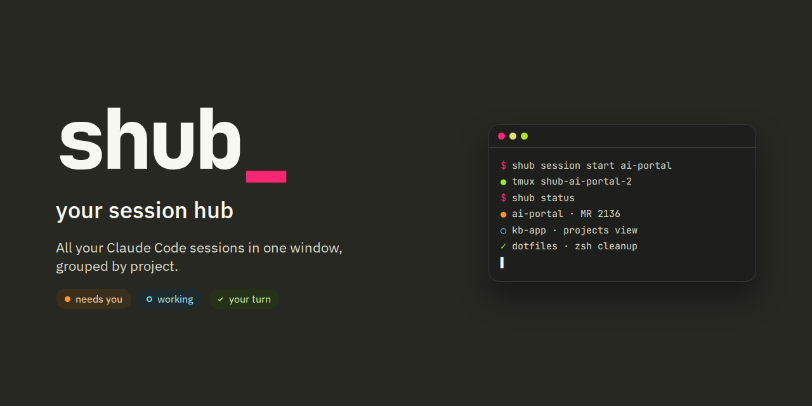

<p align="center"></p>

# shub — your session hub

All your Claude Code sessions in one window, grouped by project. shub runs the real Claude Code CLI in tmux on your
machine and shows it in the browser: one tab per session, a badge when a session needs you, the Docker services of the
session's worktree next to it, and a phone view to answer permission questions on the go.

> Status: early. Version scheme: CalVer `YYYY.M.MICRO`.

## What it does

- **Projects** with a folder, a group and an icon (detected from the git remote). Pinned ones live in the sidebar,
  dormant ones are one `Alt K` away.
- **Sessions** are real `claude` processes in tmux (`tmux -L shub`). They survive closing the browser and restarting
  shub; after a reboot shub offers to resume them.
- **Status** per session from Claude Code hooks: _needs you_, _your turn_, _working_. Desktop notifications and web push.
- **Buttons** for your skills: shub lists the project's and your global Claude skills; tick the ones you want as buttons.
- **Permission mode** for new sessions in Settings (default `default`; `auto` and the like skip prompts, `inherit` uses your Claude settings); a button's own mode wins.
- **Services panel** with the Docker Compose containers of the session's folder or worktree, PyCharm style.
- **Plain terminals** next to a session (`Alt T`).
- **Global Claude**: one session not tied to a project, for quick questions or setting up new projects.
- **Phone**: install as a PWA over Tailscale, pair with a QR code, answer permission prompts with one tap.
- **Themes**: Monokai, Dracula, Neutral dark, or your own.
- **Plugins** in any language, talking to shub's HTTP/WebSocket API. See [docs/PLUGINS.md](docs/PLUGINS.md).

## Requirements

Linux or macOS, Node 24+, tmux 3.3+, Claude Code, optionally Docker and Tailscale. Windows only inside WSL2: install
and run shub there.

## Install

```sh
npm i -g @christoph-teichmeister/shub && shub install && shub service install
```

The npm package is only the launcher (`shub`). `shub install` downloads the latest signed release from GitHub
(`--channel beta` for pre-releases), `shub service install` runs it as a systemd user unit (Linux) or a launchd agent
(macOS), at http://127.0.0.1:4780. `shub doctor` says what is missing. Versions live side by side in
`~/.local/share/shub/versions/` (`SHUB_HOME`); Settings > Updates shows new versions with their notes and installs
one when you click, `shub update` and `shub rollback` do the same in a terminal. If a new version does not come up
within 30 seconds, the launcher switches back. Sessions keep running in tmux through updates. Every other command
(`shub status`, `shub session start`, ...) goes to the installed version. Releases: [docs/RELEASING.md](docs/RELEASING.md).

## Run from a git checkout

```sh
npm install
npm run build
npm start            # http://127.0.0.1:4780
```

Started like this, shub's updates are managed by git (Settings > Updates is read-only).

On first start shub creates an access token and prints the file it lives in. Open the URL, paste the token, done.
shub only ever listens on `127.0.0.1`. For your phone, put it behind `tailscale serve` (tailnet only, never Funnel) and
set `SHUB_PUBLIC_URL` to that address. A systemd user unit example is in [deploy/shub.service](deploy/shub.service).

## Configuration

`~/.config/shub/config.json` holds projects, groups, buttons and themes and contains no secrets, so you can keep it in
your dotfiles. Secrets and runtime state live in `~/.local/state/shub/`.

## Security

shub is a full shell in a browser tab. Read [docs/SECURITY.md](docs/SECURITY.md) before exposing it to your phone. In
short: loopback only, Tailscale for remote access, a login on every request, and a permission model for Claude
sessions that use the `shub` command. Those rules only cover requests through shub; a session can still run commands
from its own shell, which only Claude Code's own permission prompts guard.

## Develop

```sh
npm run dev          # server with --watch
npm run web:dev      # Vite dev server, proxies /api to :4780
npm test             # node:test, including launcher/ and scripts/release/
npm run test:smoke   # Playwright
npm run release:dry-run   # pack, sign and install a release locally (after npm run build)
npm run typecheck && npm run lint
prek install --install-hooks   # pre-commit hooks (prek or pre-commit), tests on push
```

Architecture, the API contract and the style guide: [shared/api.ts](shared/api.ts), [docs/API.md](docs/API.md),
[docs/STYLEGUIDE.md](docs/STYLEGUIDE.md).

## License

MIT
